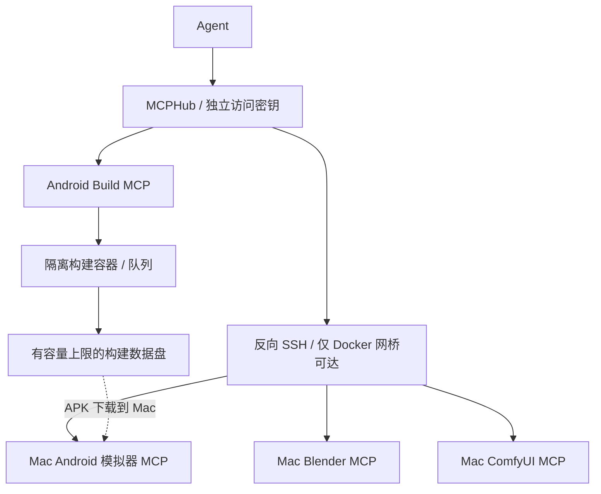

# MCP Cloud Workbench

把云端 Android 编译与 Mac 上的 Blender、ComfyUI、Android 模拟器 MCP 接入同一个 MCPHub，供不同 agent 按权限调用。Android 源码既可来自公开 GitHub，也可由 agent 直接通过 MCP 上传 `.tar.gz` 后编译，参见[源码上传说明](docs/android-source-upload.md)。

本仓库是从一套已运行并验证的部署中提取的可配置编排与适配代码，包含云端服务、Mac 代理、反向 SSH、构建隔离和存储清理。**提取后的版本尚未在第二台全新主机上完成端到端部署验证，不承诺一键全自动安装。**

## 能力与边界

| 能力 | 实现方式 |
|---|---|
| MCP 统一入口 | MCPHub 管理上游服务与客户端访问权限 |
| 调用 Mac 本地应用 | 本地 MCP → 认证 HTTP 代理 → 反向 SSH → 云端 MCPHub |
| Android 应用编译 | 独立 MCP 服务提交异步任务，Docker 容器运行 Gradle |
| 存储控制 | 80 GiB 构建数据文件系统、空间准入、任务资源限制、自动回收与手动清理工具 |
| 结果读取 | 查询状态、读取日志、下载 APK 与校验摘要 |

Android 构建范围是应用编译。发布签名管理不在范围内。云端编译成功后，可以把 APK 下载到 Mac，再通过已有模拟器 MCP 安装测试；这条模拟器测试流程未包含在已完成的构建验证中。

## 架构



云端参考环境是 OCI Ampere A1，4 核、24 GiB 内存、200 GB 系统盘，Ubuntu 24.04 ARM64。MCPHub 使用 1.1.5。无需域名时，通过 SSH 本地转发访问管理面板，服务不直接暴露到公网。

详见 [架构与信任边界](docs/architecture.md)。

## 使用入口

主机与 OCI 长期认证背景见 [OCI 说明](docs/oci.md)。

1. 复制 [配置模板](config/workbench.example.json) 为 `config/local.json`，填写自己的主机、路径和上游 MCP 配置，然后运行 `python3 scripts/init_config.py` 生成私有的 `runtime/` 文件。
2. 按 [云端部署说明](cloud/README.md) 准备 MCPHub、构建服务、存储和隧道服务端。
3. 按 [Mac 接入说明](mac/README.md) 连接已有本地 MCP，并配置启动与重连。
4. 按 [运维说明](docs/operations.md) 检查认证、存储阈值、清理和异常恢复。
5. 对照 [验证记录](docs/validation.md) 区分已验证行为和仍需自行验证的部分。

`config/local.json` 与生成的 `runtime/` 属于本机私有数据，应被 Git 忽略。不要把生成的私钥、访问令牌、日志、构建源码和 APK 提交到公开仓库。

## 目录

```text
cloud/mcphub/         MCPHub 部署模板
cloud/android-build/ Android 构建 MCP、容器与清理逻辑
mac/                 本地代理、反向隧道与启动配置
scripts/             配置生成与部署辅助脚本
config/              可公开的配置模板
tests/              自动验证脚本
docs/               架构、运维与验证说明
```

## 验证状态

原部署验证了 Blender 9 个、ComfyUI 40 个、Android 模拟器 25 个工具的接入，共 74 个 Mac 工具；Android 编译服务另有 15 个工具。测试项目 [modbus_android](https://github.com/xingyingyuzhui/modbus_android) 在指定提交上生成了 Debug APK。服务安全测试、清理、访问密钥隔离和重启后任务记录保留也已检查。

**没有运行测试项目的单元测试、lint 或模拟器测试。** 工具数量表示接口发现结果，不代表逐一执行了所有应用操作。完整证据和限制见 [验证记录](docs/validation.md)。

## 上游依赖

本仓库提供编排与适配代码，不重新分发上游软件。使用与安装各上游项目时，应查看其各自许可证和条款：

- [MCPHub](https://github.com/samanhappy/mcphub)
- [FastMCP](https://github.com/PrefectHQ/fastmcp)
- [Supergateway](https://github.com/supercorp-ai/supergateway)
- [Docker Engine](https://docs.docker.com/engine/)
- [Android SDK](https://developer.android.com/tools) 与 [Gradle](https://gradle.org/)
- [Linux ARM64 Android build-tools](https://github.com/Commit451/android-arm-build-tools)
- [Blender](https://www.blender.org/)、[ComfyUI](https://github.com/Comfy-Org/ComfyUI)、[Mobile MCP](https://github.com/mobile-next/mobile-mcp)

本仓库不替代上游服务，也不意味着获得上游商标、模型、SDK 或其他软件的再分发授权。
